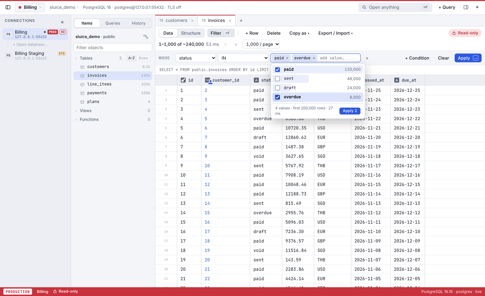

<h1 align="center">Sluice</h1>

<b>Reads flow. Writes to production stop.</b> 
A fast desktop database client that knows which server is production.

  <a href="https://github.com/yethusoe91/Sluice-releases/releases/latest"><b>Download for macOS</b></a>
  ·
  <a href="https://github.com/yethusoe91/Sluice-releases/releases">Release notes</a>

## Databases

PostgreSQL · MySQL · MariaDB · SQLite · Redis

## Why Sluice

Every connection is tagged **local**, **staging** or **production**, and production is **read-only** until you unlock it for a few minutes. A write has to get past three independent gates:

| Gate | What it stops |
|---|---|
| **1. Interface** | Edits, deletes and structure changes are locked before any SQL is written. |
| **2. Parser** | Every statement is parsed, not keyword-matched: side-effect functions, `EXPLAIN ANALYZE DELETE`, `SELECT … FOR UPDATE`, MySQL executable comments and stacked statements count as writes. |
| **3. Session** | The database session itself runs read-only, even for a superuser, so a custom function that writes is refused by the server. |

## Features

- **Fast grid** with exact paging over millions of rows, and filters that suggest values with their counts
- **Structure editor** that shows the SQL first and applies every change in one transaction
- **ER diagrams**, **schema compare** with migration SQL, and **server activity**
- **Query editor** with autocomplete, Explain, charts, saved queries and history
- **Exact values**: 64-bit integers and `DECIMAL(65,30)` are never rounded
- **SSH tunnels and TLS** (remote hosts verify certificates by default), passwords in an encrypted vault keyed by the macOS keychain
- **Ask AI** (optional): describe a query and your own Claude Code writes the SQL

## Install

1. Download the `.dmg` from the [latest release](https://github.com/yethusoe91/Sluice-releases/releases/latest) and drag **Sluice** into Applications.
2. Open it once. Builds aren't notarized by Apple yet, so macOS says it can't verify the app.
3. Go to **System Settings → Privacy & Security**, scroll down and click **Open Anyway** next to Sluice, then confirm. You only do this once; updates installed by Sluice itself don't ask again.

One universal app for Apple Silicon and Intel Macs.

## Updates

Sluice checks this repo for a new version at launch (at most every 12 hours) and from **Sluice → Check for Updates…**. It shows the release notes and installs only after you confirm. Updates are signed: Sluice refuses any update not signed with its own key. You can turn the launch check off in the update dialog.

## Privacy

- No analytics, tracking or crash reporting.
- Apart from connecting to your own databases, the only network request Sluice makes is the update check to GitHub.
- **Ask AI** is off until you use it. It sends table, column and function names, types, keys, approximate row counts, your request and the SQL in the editor to Claude through your own Claude Code. It never sends rows, passwords or connection details.
